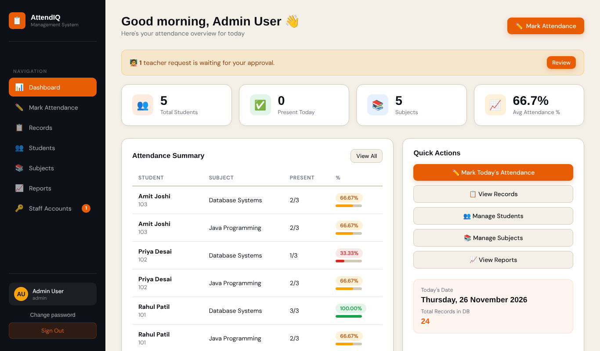
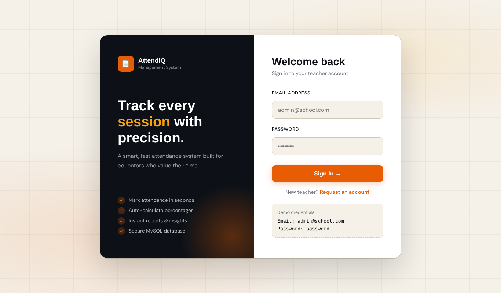
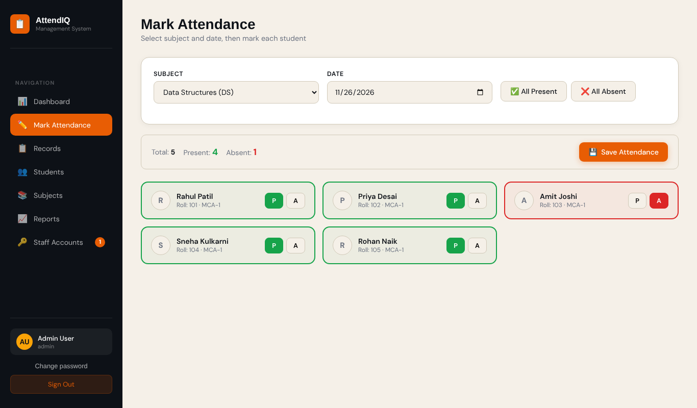
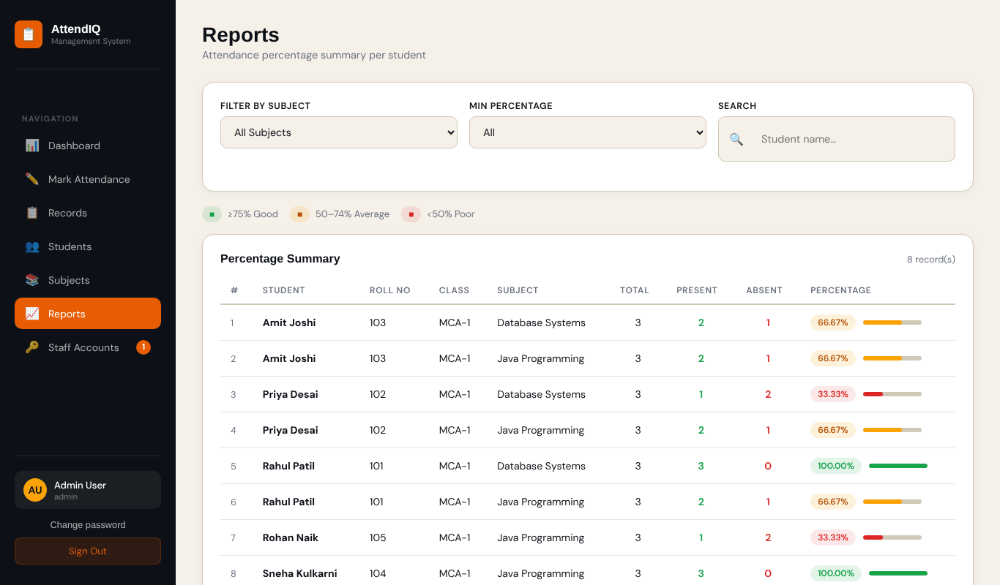
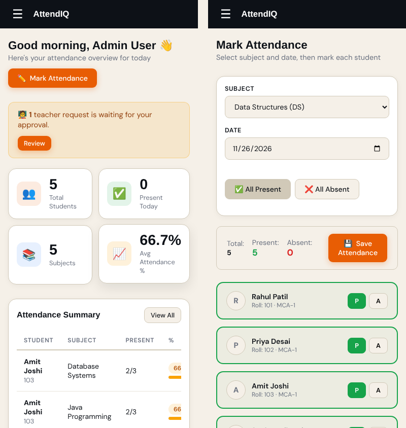
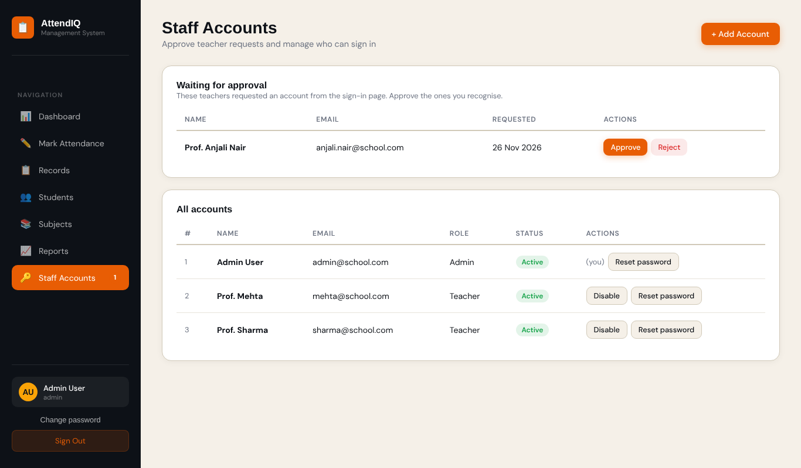

# AttendIQ

An attendance management system for colleges. Teachers pick a subject and a date, mark
each student present or absent, and the app keeps track of attendance percentages per
student and subject.

Built with **React** (Vite, React Router) on the frontend, and **Node.js, Express and MySQL**
on the backend, with JWT authentication and automated API tests.




## What it does

- Mark attendance for a whole class in one go, with "All Present" / "All Absent" shortcuts
- Correct a day's attendance later without creating duplicate entries
- See attendance percentages per student and subject, colour-coded (75%+ green, 50 to 74% amber, below 50% red)
- Filter the records by subject, date or student
- Add and edit students and subjects
- Teachers request their own account from the sign-in page; an admin approves it before they can sign in
- Two roles: teachers can mark attendance and manage students; only admins can delete things and manage staff accounts
- Everyone can change their own password, and the admin can reset a forgotten one or disable an account
- Works on phones and tablets as well as laptops



| Mark attendance | Reports |
|---|---|
|  |  |



## How teachers join

1. A teacher opens the site and clicks **"New teacher? Request an account"**, then enters their name, email and a password.
2. The request shows up for the admin: there's a badge on **Staff Accounts** and a note on the dashboard.
3. The admin clicks **Approve** (or **Reject** if they don't recognise the person). Until then the teacher can't sign in.
4. Once approved, the teacher signs in normally and can change their password from the sidebar.

When a teacher leaves, the admin **disables** their account. They are signed out straight away and can't sign in
again, but the attendance they recorded stays. (Deleting them would also delete those records, so active accounts
can only be disabled, not deleted.) The admin can also add accounts directly and reset forgotten passwords.



## How it works

The database has four tables (`users`, `students`, `subjects`, `attendance`) and one view.
A few things I relied on MySQL for:

- A `UNIQUE (student_id, subject_id, date)` key, so a student can't be marked twice for the same class
- `INSERT ... ON DUPLICATE KEY UPDATE`, so saving the same day again just corrects it
- A view, `attendance_summary`, that works out the present/absent counts and the percentage for every student and subject

Logins use bcrypt-hashed passwords and JWT tokens that expire after 8 hours. Every API
route except login needs a valid token, and deleting anything needs an admin.

## Running it locally

You'll need **Node.js 20.19+** (check with `node -v`) and **MySQL 8** (MySQL Workbench or XAMPP).

**1. Create the database.** Open `database.sql` in MySQL Workbench and click Execute (⚡).
It creates the `attendance_db` database with some sample data. It's safe to run again.

**2. Add your settings.**
```bash
cd backend
copy .env.example .env      # Mac/Linux: cp .env.example .env
```
Open `backend/.env` and set `DB_PASSWORD` to your MySQL password and `JWT_SECRET` to any
long random text. You can generate one with:
```bash
node -e "console.log(require('crypto').randomBytes(32).toString('hex'))"
```

**3. Install, build and start.** From the main project folder:
```bash
npm run setup      # installs the backend and frontend packages (first time only)
npm run build      # builds the React app into frontend/dist
npm start          # starts the server
```

**4. Open http://localhost:5000** and sign in with one of the demo accounts:

| Role | Email | Password |
|---|---|---|
| Admin | admin@school.com | password |
| Teacher | sharma@school.com | password |
| Teacher | mehta@school.com | password |

These are only for trying it out; change or remove them before using it for real.
New teachers can request an account from the sign-in page; approve them on **Staff Accounts**.

To open it on your phone, connect to the same Wi-Fi and go to `http://<your-computer's-IP>:5000`.
(If you set `PORT` in `backend/.env`, use that port instead of 5000.)

### While changing the code

Run the backend and the React dev server in two terminals:
```bash
npm run dev:backend     # API, restarts when you edit backend files
npm run dev:frontend    # React app at http://localhost:5173, updates instantly when you edit
```
The React dev server forwards `/api` requests to the backend (it reads the port from `backend/.env`).
After changing the frontend, run `npm run build` again so `npm start` serves the new version.

## How the React app is organised

- **`App.jsx`** lists the routes (`/dashboard`, `/students`, ...). Route guards send signed-out users to the
  sign-in page and keep teachers out of admin pages.
- **`AuthContext.jsx`** keeps the signed-in user for the whole app (React Context). `useAuth()` gives any
  component the user, `isAdmin`, `login()` and `logout()`.
- **`api.js`** wraps `fetch`: adds the JWT to every request and signs the user out if the server answers 401.
- **`components/Layout.jsx`** is the sidebar and phone menu around every page; the page itself renders in `<Outlet />`.
- **`pages/`** has one component per screen. Each loads its data with `useEffect` and keeps form inputs in `useState`.
- React escapes text automatically, so a student name containing HTML is shown as text, never run as code.

## API

All routes except login need an `Authorization: Bearer <token>` header.

| Method | Endpoint | Who | What it does |
|---|---|---|---|
| POST | /api/auth/login | anyone | Sign in, returns a token (only for approved, active accounts) |
| POST | /api/auth/signup | anyone | Request a teacher account (starts as pending) |
| POST | /api/auth/change-password | staff | Change your own password |
| GET | /api/users | admin | List staff accounts, pending requests first |
| GET | /api/users/pending-count | admin | Number of requests waiting |
| POST | /api/users | admin | Create a teacher or admin account directly |
| PATCH | /api/users/:id/status | admin | Approve, disable or re-enable an account |
| POST | /api/users/:id/reset-password | admin | Set a new password for someone |
| DELETE | /api/users/:id | admin | Reject a pending request |
| GET | /api/students | staff | List students |
| GET | /api/students/:id | staff | One student |
| POST | /api/students | staff | Add a student |
| PUT | /api/students/:id | staff | Edit a student |
| DELETE | /api/students/:id | admin | Delete a student and their attendance |
| GET | /api/subjects | staff | List subjects |
| POST | /api/subjects | staff | Add a subject |
| DELETE | /api/subjects/:id | admin | Delete a subject and its attendance |
| POST | /api/attendance/mark | staff | Save attendance for a subject and date |
| GET | /api/attendance/by-date | staff | Records, filtered by `date` and/or `subject_id` |
| GET | /api/attendance/summary | staff | Percentages per student and subject |
| GET | /api/attendance/stats | staff | Numbers for the dashboard |
| GET | /api/attendance/student/:id | staff | One student's full history |
| DELETE | /api/attendance/:id | admin | Delete one record |

## Tests

```bash
cd backend
npm test
```
The tests create a separate `attendance_test` database from `database.sql` and run real
requests against it: login, sign-up and approval, disabling accounts, passwords, permissions,
validation, marking and correcting attendance, and the percentage calculations. GitHub Actions runs them on every push with a MySQL 8 database, and also checks that the React app builds.

## Project layout

```
database.sql          Tables, view and sample data
backend/
  server.js           Checks settings, connects to MySQL, starts the app
  app.js              Express app: routes, serves the React build, error handling
  config/db.js        MySQL connection pool
  config/migrate.js   Updates an older database automatically on start-up
  middleware/auth.js  Token check (also blocks disabled accounts) and admin check
  routes/             auth, users, students, subjects, attendance
  tests/              API tests
frontend/               React app (Vite)
  index.html            The single HTML page React renders into
  vite.config.js        Dev server and /api proxy
  src/main.jsx          Starts React: router, auth and toast providers
  src/App.jsx           Routes and route guards
  src/AuthContext.jsx   Signed-in user, login and logout
  src/api.js            fetch wrapper (JWT, 401 handling)
  src/useSubjects.js    Custom hook that loads the subject list
  src/components/       Layout (sidebar), Modal, Toast, PasswordModal, AuthShell, EmptyRow
  src/pages/            Login, Signup, Dashboard, MarkAttendance, Records, Students, Subjects, Reports, Users
  src/styles/           CSS, including the phone layout
package.json            Shortcuts: setup, build, start, test
```

## Changes since the first version

While testing the first version I found and fixed these:

- Logging in failed with "Server error" on a fresh setup, because `JWT_SECRET` wasn't documented and there was no `.env.example`. The server now explains exactly what is missing.
- The Records page showed "Invalid Date" for every row. MySQL dates were being converted to UTC on the way to the browser, so they now come through as plain `YYYY-MM-DD`.
- Anyone could call the register endpoint and make themselves an admin. Teachers now request an account and an admin approves it; nobody can sign up as an admin.
- Admin and teacher had the same permissions. Deleting is now admin-only.
- Student and subject names were put into the page as HTML, so a name containing a script would run in other users' browsers. Everything is escaped now. A name with an apostrophe, like D'Souza, also used to break the Delete button.
- Raw database errors were shown to users; they now get a clear message instead.
- Students nobody clicked on were saved as Absent without warning; the app now asks first.
- The app wasn't usable on phones; it now has a phone layout with a slide-in menu.
- `database.sql` failed if it was run twice; it can now be run again safely.
- Rebuilt the frontend in **React**. The first version was nine separate HTML pages that each built their
  tables by joining strings of HTML. Now it's one React app with reusable components (sidebar, dialogs,
  toasts), shared state for the signed-in user, and client-side routing. The backend didn't change.
- Swapped `bcrypt` for `bcryptjs` (no native build step on Windows), dropped `nodemon` for Node's built-in `--watch`, and updated dependencies, so `npm audit` now reports 0 vulnerabilities.

## License

[MIT](LICENSE)
